# Práctica: Configuración de seguridad en una base de datos (App + DB) con Vagrant y VMware

**Materia:** Base de Datos en la Nube · PUCE Manabí
**Docente:** Ing. Alex Fernando Ricaurte Segovia
**Estudiante:** Santiago Esquetini

Este repositorio monta en local, con **Vagrant + VMware Workstation**, la arquitectura de la guía *"Configuración de red en Azure para una aplicación y base de datos"*. En lugar de Microsoft Azure se usan tres máquinas virtuales que reproducen la VNet, sus dos subredes, el Network Security Group (NSG) de la base de datos y la conexión de la aplicación a la base de datos por IP privada.

---

## 1. Problema y objetivo

**Problema.** Se necesitan dos máquinas: una para la aplicación y otra para la base de datos. La aplicación debe conectarse a la base de datos de forma segura, y la base de datos **no** debe ser accesible desde fuera.

**Objetivo.** Diseñar e implementar una red segmentada con comunicación privada entre las dos máquinas. La base de datos solo debe aceptar conexiones desde la subred de la aplicación y únicamente en el puerto del motor (MySQL, 3306).

## 2. Equivalencia Azure → laboratorio local

| Guía de Azure | Implementación en este repositorio |
|---|---|
| Virtual Network `10.0.0.0/16` | Dos redes privadas de VMware: `vmnet2` y `vmnet3` |
| Subred de la aplicación `10.0.1.0/24` | `vmnet2` → VM **app** con IP `10.0.1.10` |
| Subred de la base de datos `10.0.2.0/24` | `vmnet3` → VM **db** con IP `10.0.2.10` |
| Enrutamiento interno de Azure | VM **router** (`10.0.1.1` / `10.0.2.1`) con `ip_forward=1` |
| VM de la app con IP pública | La VM app sale a Internet a través del router (NAT) |
| VM de la base de datos sin IP pública | MySQL escucha solo en `10.0.2.10`, una IP privada que no se enruta hacia fuera |
| NSG de la base de datos | Firewall **UFW** en la VM db: solo `10.0.1.0/24` → `3306/tcp` |
| Conexión app → DB por IP privada | `mysql -h 10.0.2.10` desde la VM app |

## 3. Arquitectura

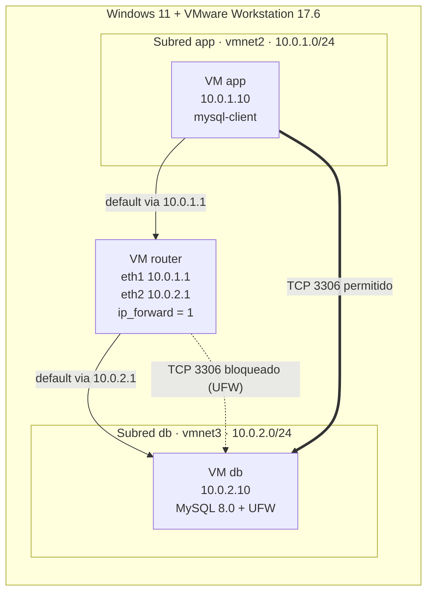

| VM | Hostname | Interfaces privadas | RAM | Función |
|---|---|---|---|---|
| router | `router` | `10.0.1.1` (vmnet2), `10.0.2.1` (vmnet3) | 1 GB | Enruta entre subredes y hace NAT de salida |
| app | `app` | `10.0.1.10` (vmnet2) | 1 GB | Aplicación (cliente MySQL y curl) |
| db | `db` | `10.0.2.10` (vmnet3) | 1 GB | Servidor MySQL protegido con UFW |

> Las tres VMs tienen además la interfaz `eth0` (NAT de VMware, `192.168.0.x`). Vagrant la crea siempre para administrarlas con `vagrant ssh`. En la VM db esa interfaz **solo** acepta SSH (puerto 22), y MySQL no escucha en ella (ver la sección 6).

## 4. Estructura del repositorio

```
seguridad-bd-vagrant/
├── Vagrantfile                 # Define las 3 VMs (router, app, db) con el proveedor vmware_desktop
├── provision/
│   ├── router.sh               # Activa net.ipv4.ip_forward
│   ├── router_nat.sh           # NAT de salida (MASQUERADE), se ejecuta en cada arranque
│   ├── ruta_default.sh         # Ruta por defecto hacia el router de cada subred
│   ├── app.sh                  # Instala mysql-client y curl
│   └── db.sh                   # MySQL con bind-address privado, UFW (NSG), base de datos y usuario
├── host/
│   └── crear_redes_vmware.ps1  # Crea vmnet2 y vmnet3 en VMware (como Administrador)
└── capturas/                   # Evidencias de cada paso
```

## 5. Paso a paso

### 5.1 Requisitos e instalación de herramientas

- **VMware Workstation 17** (ya instalado en el equipo)
- **Vagrant 2.4.9**: `winget install Hashicorp.Vagrant`
- **Vagrant VMware Utility 1.0.24**: el servicio que conecta Vagrant con VMware ([descarga](https://developer.hashicorp.com/vagrant/install/vmware))
- **Plugin del proveedor:** `vagrant plugin install vagrant-vmware-desktop`

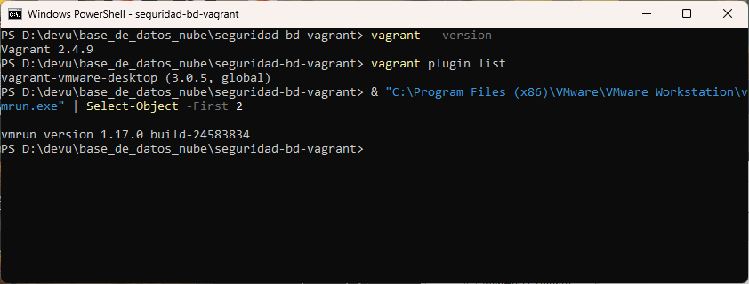

*Figura 1. Versiones de Vagrant, del plugin `vagrant-vmware-desktop` y de `vmrun` de VMware Workstation.*

### 5.2 Creación de la red virtual y las subredes

En Azure se crearía una VNet con dos subredes. En VMware se crean dos redes privadas (host-only), **sin DHCP y sin IP del host dentro de ellas**, así que solo las VMs conectadas se comunican entre sí. Para crearlas se ejecuta `host/crear_redes_vmware.ps1` como Administrador:

```powershell
vnetlib64.exe -- add adapter vmnet2
vnetlib64.exe -- set vnet vmnet2 mask 255.255.255.0
vnetlib64.exe -- set vnet vmnet2 addr 10.0.1.0     # subred de la app
# ...lo mismo con vmnet3 y 10.0.2.0                # subred de la base de datos
```

El plugin de Vagrant busca la vmnet cuya subred coincide con la IP que se pone en el `Vagrantfile` y conecta ahí la tarjeta de red: `10.0.1.x` va a `vmnet2` y `10.0.2.x` va a `vmnet3`.

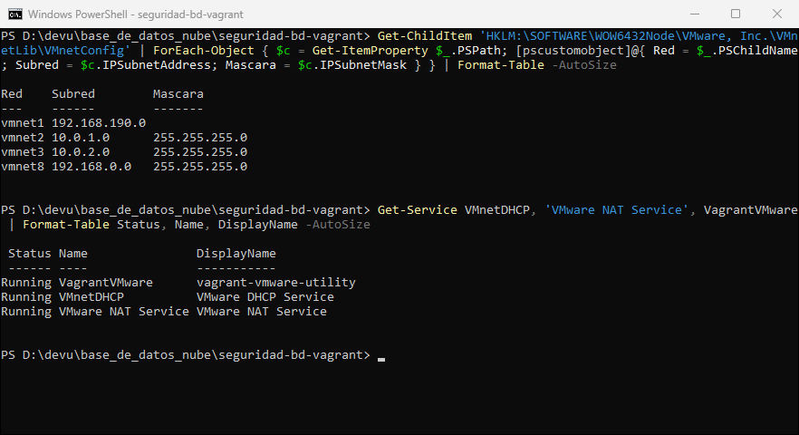

*Figura 2. Redes de VMware: `vmnet2 = 10.0.1.0/24` (app) y `vmnet3 = 10.0.2.0/24` (db), con los servicios DHCP, NAT y Vagrant VMware Utility en ejecución.*

### 5.3 El Vagrantfile

Este es el fragmento principal. El archivo completo está en [`Vagrantfile`](Vagrantfile).

```ruby
config.vm.box = "bento/ubuntu-22.04"          # box compatible con VMware

config.vm.define "router" do |r|
  r.vm.network "private_network", ip: "10.0.1.1"   # interfaz en la subred app
  r.vm.network "private_network", ip: "10.0.2.1"   # interfaz en la subred db
  r.vm.provision "shell", path: "provision/router.sh"
  r.vm.provision "shell", path: "provision/router_nat.sh", run: "always"
end

config.vm.define "app" do |a|
  a.vm.network "private_network", ip: "10.0.1.10"
  a.vm.provision "shell", path: "provision/ruta_default.sh", args: ["10.0.1.1"], run: "always"
  a.vm.provision "shell", path: "provision/app.sh"
end

config.vm.define "db" do |d|
  d.vm.network "private_network", ip: "10.0.2.10"
  d.vm.provision "shell", path: "provision/ruta_default.sh", args: ["10.0.2.1"], run: "always"
  d.vm.provision "shell", path: "provision/db.sh"
end
```

Cambios respecto al Vagrantfile original de la guía, que estaba pensado para VirtualBox:

| Original (VirtualBox) | Este repo (VMware) | Motivo |
|---|---|---|
| `ubuntu/jammy64` | `bento/ubuntu-22.04` | `ubuntu/jammy64` solo existe para VirtualBox |
| `virtualbox__intnet: "intnet-app"` | `vmnet2` (10.0.1.0/24) | VMware usa vmnets en lugar de *internal networks* |
| `vb.memory = 512` en el router | `v.memory = 1024` | Con 512 MB el kernel de la box daba *kernel panic* al arrancar |
| `-o enp0s3` en el MASQUERADE | Se detecta la interfaz de salida | En VMware la interfaz NAT se llama `eth0` |
| `ufw default deny incoming` sin SSH | Se agrega `allow in on eth0 port 22` | Sin esa regla, `vagrant ssh db` queda bloqueado |
| Ruta por defecto con `ip route replace` una sola vez | Provisioner con `run: "always"` | La ruta no es persistente y se pierde al reiniciar |

### 5.4 Despliegue de las máquinas virtuales

```powershell
vagrant up            # crea router, app y db en ese orden y las aprovisiona
vagrant status
```

En el aprovisionamiento de la VM db se ve cómo se instala MySQL, cómo se aplican las reglas del firewall y cómo se crea la base de datos:

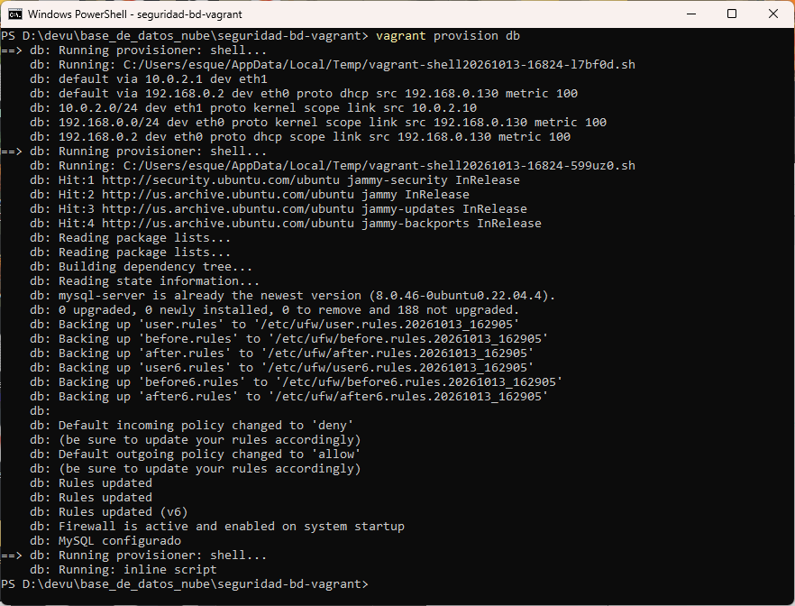

*Figura 3. `vagrant provision db`: ruta por defecto vía `10.0.2.1`, MySQL instalado, políticas de UFW (`deny` de entrada) y "MySQL configurado".*

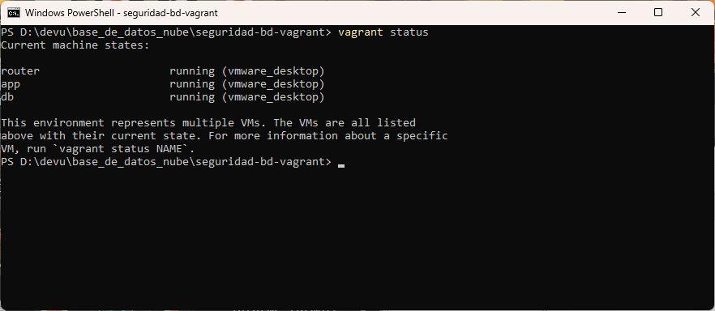

*Figura 4. Las tres máquinas en estado `running (vmware_desktop)`.*

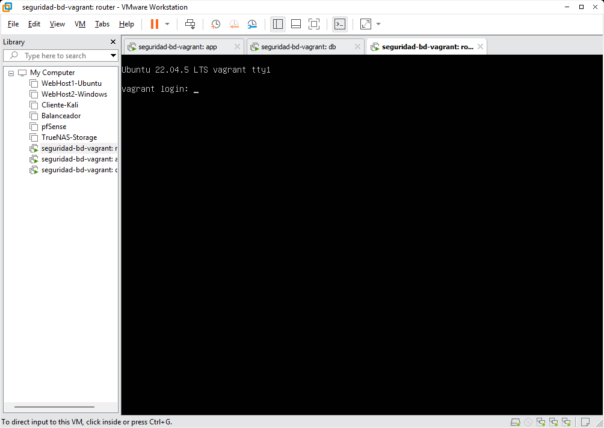

*Figura 5. Las tres VMs (app, db y router) encendidas en VMware Workstation.*

### 5.5 Verificación del router

```bash
vagrant ssh router
ip a                          # debe mostrar 10.0.1.1 y 10.0.2.1
sysctl net.ipv4.ip_forward    # debe devolver = 1
```

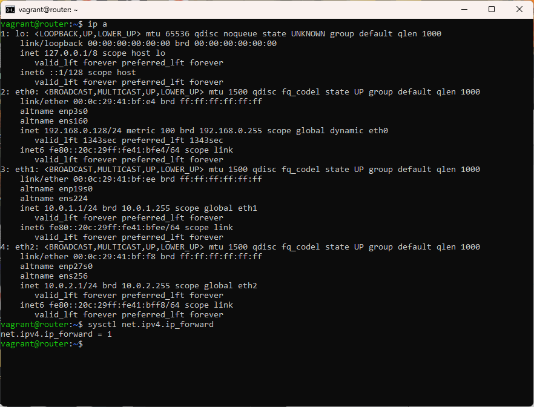

*Figura 6. El router tiene `eth1 = 10.0.1.1/24` (subred app) y `eth2 = 10.0.2.1/24` (subred db), y el reenvío de paquetes está activo (`net.ipv4.ip_forward = 1`).*

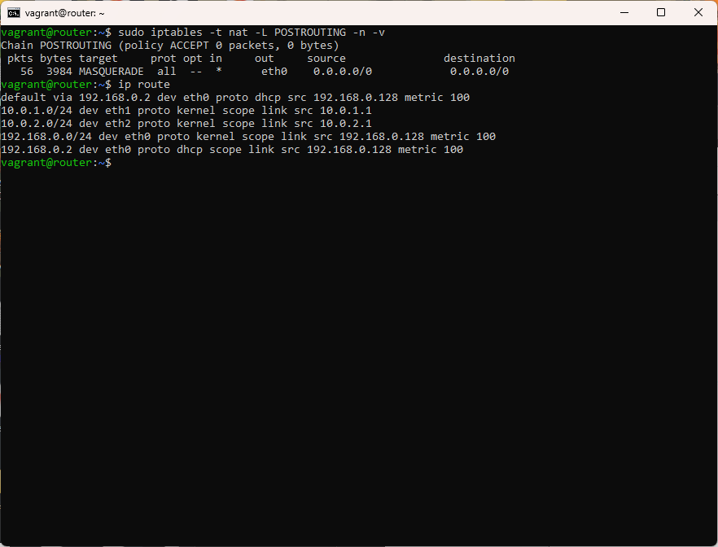

*Figura 7. Regla `MASQUERADE` por `eth0`, que da salida a Internet a las subredes, y tabla de rutas del router con las dos subredes conectadas.*

### 5.6 Verificación de la VM app

```bash
vagrant ssh app
ip a                    # debe mostrar 10.0.1.10
ip route                # default via 10.0.1.1
ping -c 2 10.0.2.10     # debe responder
```

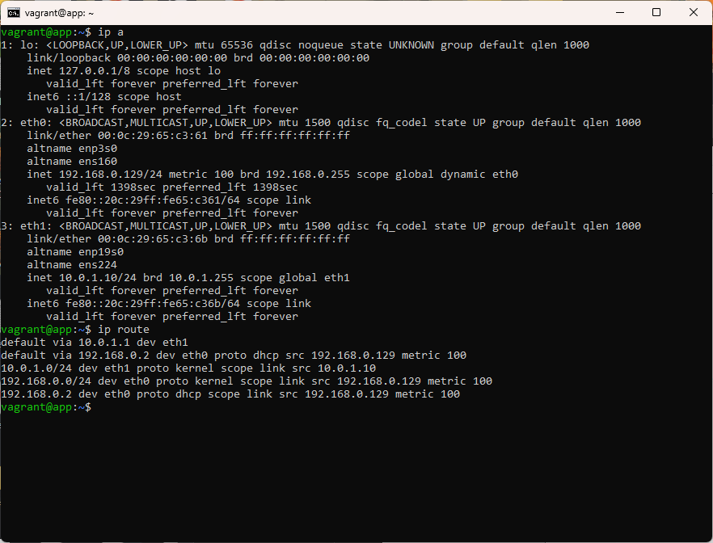

*Figura 8. La VM app tiene la IP `10.0.1.10/24` y su ruta por defecto es `default via 10.0.1.1 dev eth1`, es decir, el router.*

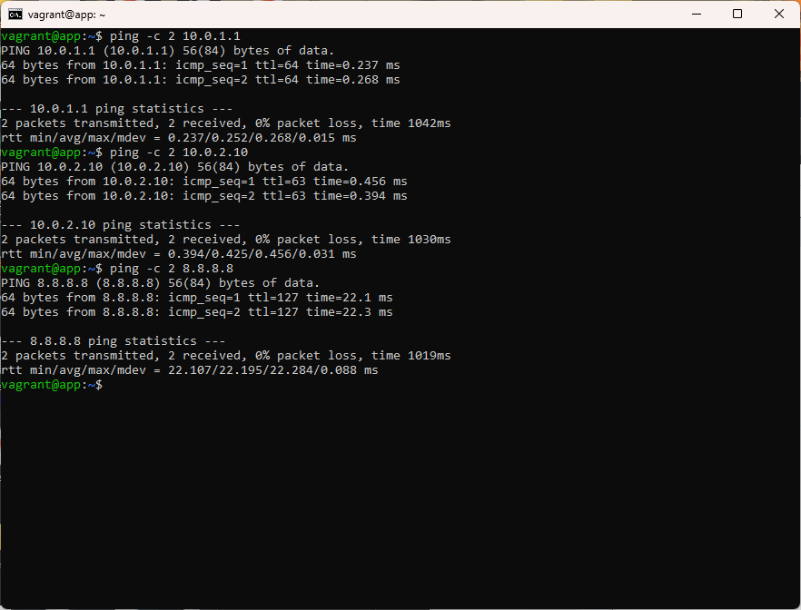

*Figura 9. Desde app hay ping al router (`10.0.1.1`), a la base de datos en otra subred (`10.0.2.10`, `ttl=63` porque pasa por el router) y a Internet (`8.8.8.8`).*

### 5.7 Verificación de la VM db y del "NSG"

```bash
vagrant ssh db
ip a                       # debe mostrar 10.0.2.10
sudo ufw status verbose    # NSG simulado
```

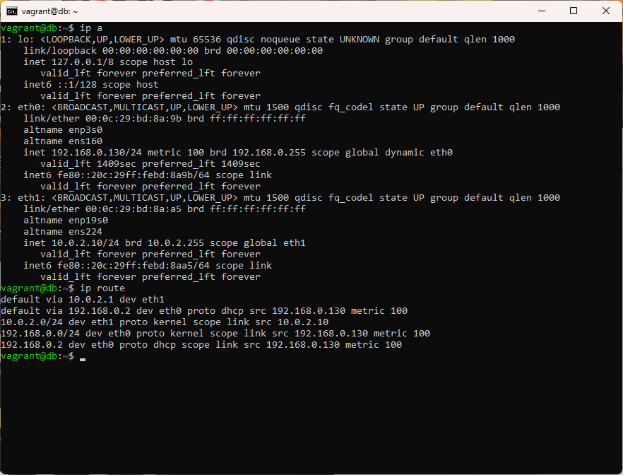

*Figura 10. La VM db tiene la IP `10.0.2.10/24` y su ruta por defecto pasa por `10.0.2.1`.*

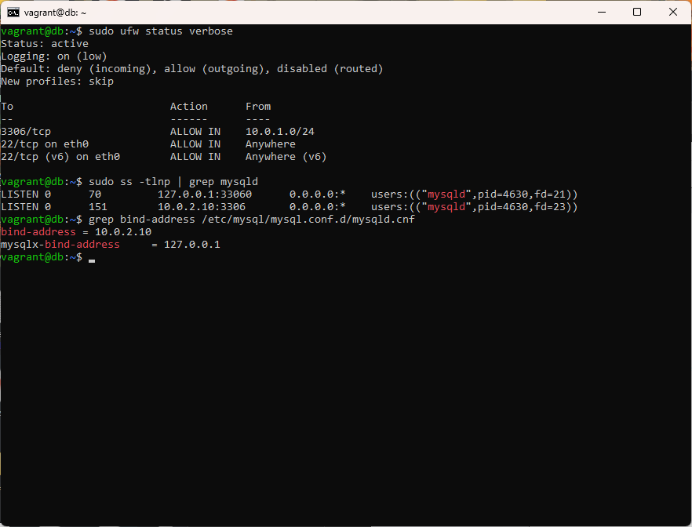

*Figura 11. Reglas del firewall: entrada denegada por defecto, `3306/tcp` permitido **solo desde `10.0.1.0/24`** y SSH solo por la interfaz de administración. `mysqld` escucha únicamente en `10.0.2.10:3306` (`bind-address = 10.0.2.10`).*

Esta es la configuración de `provision/db.sh` que implementa el NSG:

```bash
sed -i 's/^bind-address.*/bind-address = 10.0.2.10/' /etc/mysql/mysql.conf.d/mysqld.cnf
ufw --force reset
ufw default deny incoming
ufw default allow outgoing
ufw allow from 10.0.1.0/24 to any port 3306 proto tcp   # solo la subred de la app
ufw allow in on "$MGMT" to any port 22 proto tcp        # administración con vagrant ssh
ufw --force enable
```

### 5.8 Base de datos y usuario con mínimo privilegio

Se crea la base de datos `empresa_db` con la tabla `clientes`. El usuario de la aplicación **solo puede conectarse desde la subred `10.0.1.%`** y solo tiene permisos de datos (sin `DROP`, `CREATE` ni `GRANT`):

```sql
CREATE DATABASE IF NOT EXISTS empresa_db;
CREATE USER IF NOT EXISTS 'app_user'@'10.0.1.%' IDENTIFIED BY 'AppSegura#2026';
GRANT SELECT, INSERT, UPDATE, DELETE ON empresa_db.* TO 'app_user'@'10.0.1.%';
```

> La contraseña es de laboratorio y solo se usa dentro de estas VMs. En un entorno real iría en una variable de entorno o en un gestor de secretos, como Azure Key Vault.

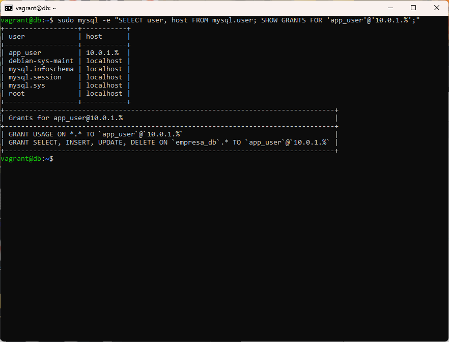

*Figura 12. El único usuario remoto es `app_user@10.0.1.%`; `root` solo existe en `localhost`.*

### 5.9 Conexión de la aplicación a la base de datos por IP privada

```bash
vagrant ssh app
mysql -h 10.0.2.10 -u app_user -p empresa_db
```

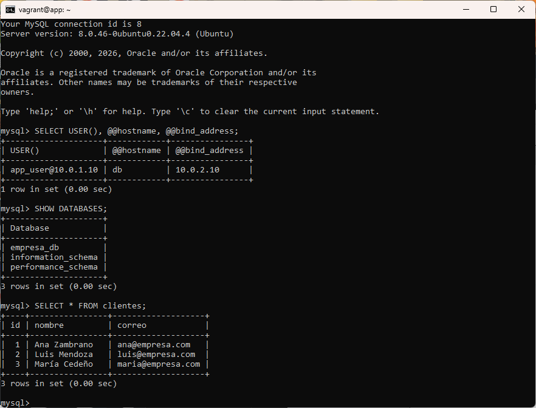

*Figura 13. Desde la VM app se conecta a `10.0.2.10`. `USER()` devuelve `app_user@10.0.1.10`, el servidor es `db` y su `bind_address` es `10.0.2.10`. Se listan los registros de `clientes`.*

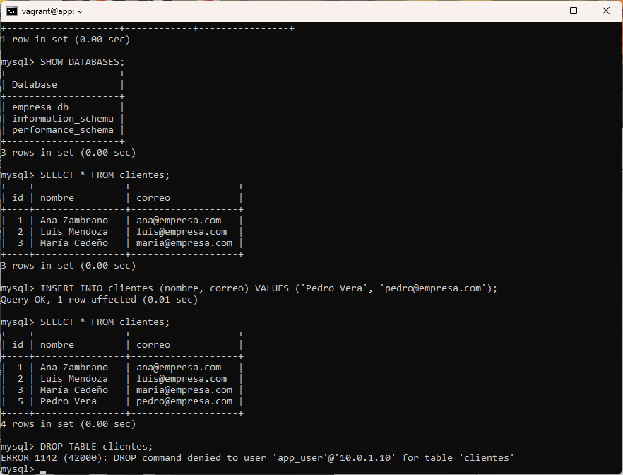

*Figura 14. El usuario de la aplicación puede insertar datos, pero `DROP TABLE` es rechazado (`ERROR 1142 ... DROP command denied`), así que tiene el mínimo privilegio.*

### 5.10 Pruebas de seguridad: la base de datos no es accesible desde fuera

**Desde el router.** Está en la subred de la base de datos (`10.0.2.1`), pero **no** en la subred de la app:

```bash
ping -c 2 10.0.2.10              # responde: hay conectividad de red
nc -zv -w 5 10.0.2.10 3306       # timed out: UFW bloquea el puerto
```

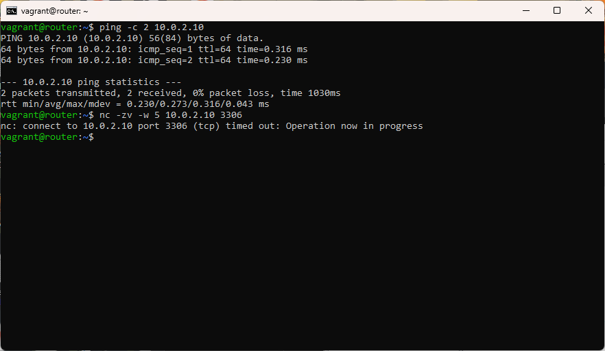

*Figura 15. El router llega por red a la VM db (el ping responde), pero la conexión al 3306 expira: el firewall solo deja pasar a `10.0.1.0/24`.*

**Desde Windows (el "Internet" de este laboratorio):**

```powershell
ping -n 2 10.0.2.10
Test-NetConnection 10.0.2.10 -Port 3306       # IP privada: no hay ruta
Test-NetConnection 192.168.0.130 -Port 3306   # IP de administración de db: bloqueado
```

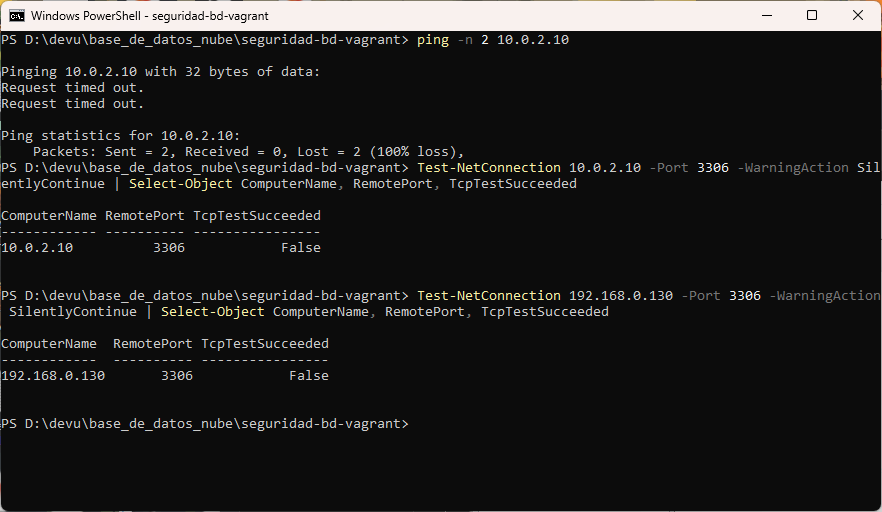

*Figura 16. Desde el equipo anfitrión no hay ping a `10.0.2.10` y `TcpTestSucceeded = False`, tanto por la IP privada como por la IP de administración de la VM db.*

### Resumen de pruebas

| Origen | Destino | Resultado | Por qué |
|---|---|---|---|
| app `10.0.1.10` | db `10.0.2.10` ICMP | ✅ responde | Ruta vía router |
| app `10.0.1.10` | db `10.0.2.10:3306` | ✅ conecta | Regla UFW `10.0.1.0/24 → 3306` + usuario `app_user@10.0.1.%` |
| app (`app_user`) | `DROP TABLE` | ❌ denegado | Mínimo privilegio en MySQL |
| router `10.0.2.1` | db `10.0.2.10:3306` | ❌ timeout | No pertenece a la subred de la app |
| Windows | db `10.0.2.10:3306` | ❌ sin ruta | Subred privada sin salida hacia fuera |
| Windows | db `192.168.0.130:3306` | ❌ bloqueado | MySQL no escucha ahí y UFW lo deniega |

## 6. Buenas prácticas aplicadas (punto 8 de la guía)

1. **Separar aplicación y base de datos en subredes distintas:** `10.0.1.0/24` y `10.0.2.0/24`, en vmnets diferentes y comunicadas solo a través del router.
2. **Evitar exponer la base de datos a Internet:** MySQL hace `bind` solo a la IP privada `10.0.2.10`, y la subred `10.0.2.0/24` no es alcanzable desde el anfitrión.
3. **Limitar las reglas de seguridad por rango de IP:** UFW permite el 3306 solo desde `10.0.1.0/24`, y MySQL acepta al usuario solo desde `10.0.1.%`.
4. **Usar IP privadas para la comunicación interna:** la app se conecta con `mysql -h 10.0.2.10`.

**Limitación del laboratorio.** Vagrant necesita una interfaz NAT (`eth0`) en cada VM para administrarlas, así que la VM db no puede quedar "sin ninguna IP externa" como en Azure. Para compensarlo, en esa interfaz MySQL no escucha y UFW solo permite SSH, como se comprobó en la figura 16.

## 7. Problemas encontrados y cómo se resolvieron

| Problema | Causa | Solución |
|---|---|---|
| `vagrant up` se quedaba en *"Waiting for the VM to receive an address..."* | El servicio **VMware DHCP** no arrancaba porque en el registro tenía VMnet8 en `192.168.16.1`, mientras que el adaptador real estaba en `192.168.0.1` (*"No subnet declaration for VMnet8"*) | Se corrigió `HostIpAddress` en `HKLM\SYSTEM\CurrentControlSet\Services\VMnetDHCP\Parameters\VirtualEthernetSegments\8` y se iniciaron los servicios VMnetDHCP y VMware NAT |
| *Kernel panic: System is deadlocked on memory* en el router | 512 MB no alcanzan para la box `bento/ubuntu-22.04` | Se subió la memoria a 1024 MB |
| La box `ubuntu/jammy64` no existe para VMware | Solo está publicada para VirtualBox | Se usó `bento/ubuntu-22.04` |
| Con `ufw default deny incoming` se perdía `vagrant ssh db` | La guía no permitía SSH | Se permite el 22 solo en la interfaz de administración |

## 8. Cómo reproducirlo

```powershell
# 1. (Administrador) crear las redes privadas de VMware
powershell -ExecutionPolicy Bypass -File host\crear_redes_vmware.ps1

# 2. Levantar el laboratorio
vagrant up

# 3. Probar
vagrant ssh app -c "ping -c 2 10.0.2.10"
vagrant ssh app -c "mysql -h 10.0.2.10 -u app_user -p empresa_db"

# 4. Apagar o eliminar
vagrant halt
vagrant destroy -f
```

## 9. Conclusión

Con tres máquinas virtuales en VMware se reprodujo la arquitectura de la guía de Azure: una red con dos subredes, un router que hace el papel del enrutamiento interno de la VNet y un firewall en la base de datos que funciona como el NSG. La aplicación se conecta a MySQL por la IP privada `10.0.2.10`. Cualquier otro origen, incluido el router que está en la misma subred y el propio equipo anfitrión, queda bloqueado en el puerto 3306. Así se cumplen el objetivo de la práctica y las buenas prácticas de segmentación, mínimo privilegio y no exposición de la base de datos.
