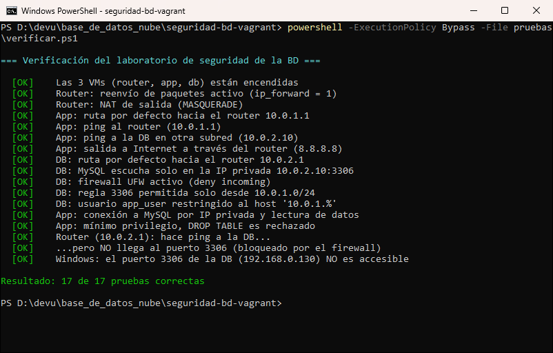

# Guía de verificación paso a paso

Esta guía sirve para **demostrar en vivo** que el laboratorio funciona. Cada paso indica qué comando ejecutar, qué resultado debe aparecer y cómo explicarlo.

Todos los comandos se ejecutan en **PowerShell**, desde la carpeta del repositorio:

```powershell
cd D:\devu\base_de_datos_nube\seguridad-bd-vagrant
```

> Si `vagrant` no se reconoce, primero ejecutar: `$env:Path = "C:\Program Files\Vagrant\bin;$env:Path"`

**Recordatorio de la arquitectura:**

| VM | Subred | IP privada | Rol |
|---|---|---|---|
| router | ambas | 10.0.1.1 y 10.0.2.1 | Une las dos subredes (como la VNet de Azure) |
| app | subred app (10.0.1.0/24) | 10.0.1.10 | Servidor de aplicación (cliente MySQL) |
| db | subred db (10.0.2.0/24) | 10.0.2.10 | Servidor MySQL protegido por el firewall (NSG) |

---

## Opción rápida: todas las pruebas de una vez

```powershell
powershell -ExecutionPolicy Bypass -File pruebas\verificar.ps1
```

**Resultado esperado:** `Resultado: 17 de 17 pruebas correctas` (todas en `[OK]`, en verde).



El script ejecuta las mismas comprobaciones que se describen abajo, una por una. Para explicar la práctica conviene hacerlas manualmente siguiendo los pasos.

---

## Paso 0. Encender el laboratorio

```powershell
vagrant up          # solo si las VMs están apagadas (tarda unos minutos)
vagrant status
```

**Esperado:** `router`, `app` y `db` aparecen como `running (vmware_desktop)`.

**Explicación:** las tres máquinas se crean con un solo `Vagrantfile` (infraestructura como código). Equivalen a las VMs que en Azure se crearían desde el portal.

---

## Paso 1. El router une las dos subredes

```powershell
vagrant ssh router
```

Dentro de la VM:

```bash
ip -br addr                 # debe tener 10.0.1.1 y 10.0.2.1
sysctl net.ipv4.ip_forward  # esperado: net.ipv4.ip_forward = 1
exit
```

**Explicación:** el router tiene una interfaz en cada subred y reenvía paquetes entre ellas (`ip_forward = 1`). En Azure no hace falta esta VM, porque la VNet enruta automáticamente entre sus subredes.

---

## Paso 2. La app llega a la DB por la red privada

```powershell
vagrant ssh app
```

```bash
ip route                    # esperado: default via 10.0.1.1
ping -c 3 10.0.1.1          # router         -> 0% packet loss
ping -c 3 10.0.2.10         # db (otra subred) -> 0% packet loss
```

**Explicación:** la app está en 10.0.1.0/24 y la DB en 10.0.2.0/24. El ping a la DB funciona porque el tráfico pasa por el router. Esto demuestra que **existe conectividad de red** entre las subredes. Lo que se restringe es el **puerto de la base de datos**, como se verá en el paso 5.

---

## Paso 3. La app se conecta a MySQL con el usuario de mínimo privilegio

Desde la VM **app** (continuación del paso anterior):

```bash
mysql -h 10.0.2.10 -u app_user -p empresa_db
# contraseña: AppSegura#2026  (contraseña de laboratorio, ver provision/db.sh)
```

Dentro de MySQL:

```sql
SELECT USER(), @@hostname;       -- app_user@10.0.1.10 | db
SELECT * FROM clientes;          -- muestra los 3 clientes de prueba
SHOW GRANTS;                     -- solo SELECT, INSERT, UPDATE, DELETE
DROP TABLE clientes;             -- ERROR 1142: DROP command denied
exit
```

Salir también de la VM con `exit`.

**Explicación:**
- La conexión usa la **IP privada** 10.0.2.10. La base de datos no tiene IP pública.
- `USER()` muestra que MySQL ve a la app como `10.0.1.10`, es decir, desde la subred permitida.
- El `DROP TABLE` falla porque el usuario solo tiene permisos de datos y no de estructura. Este es el **principio de mínimo privilegio**.

---

## Paso 4. La configuración de seguridad de la DB

```powershell
vagrant ssh db
```

```bash
sudo ufw status verbose
sudo ss -ltnp | grep 3306
sudo mysql -e "SELECT user, host FROM mysql.user;"
```

**Esperado:**

| Comando | Qué debe verse | Equivalente en Azure |
|---|---|---|
| `ufw status verbose` | `Status: active`, `deny (incoming)`, `3306/tcp ALLOW IN 10.0.1.0/24` | Reglas del **NSG**: denegar todo y permitir solo la subred app |
| `ss -ltnp` | `10.0.2.10:3306` (no `0.0.0.0`) | La DB **sin IP pública**, escuchando solo en la red privada |
| `mysql.user` | `app_user` con host `10.0.1.%` | El usuario solo puede autenticarse desde la subred app |

Salir con `exit`.

**Explicación:** la protección tiene **tres capas**: el firewall (red), el `bind-address` (servicio) y el host del usuario (base de datos). Aunque una de ellas fallara, las otras dos seguirían bloqueando el acceso.

---

## Paso 5. Desde fuera de la subred app, el 3306 está bloqueado

### 5.1 Desde el router (IP 10.0.2.1, que no pertenece a 10.0.1.0/24)

```powershell
vagrant ssh router
```

```bash
ping -c 3 10.0.2.10           # responde (hay red)
nc -zv -w 3 10.0.2.10 3306    # "timed out" -> el puerto está bloqueado
exit
```

**Explicación:** es la prueba clave. El router **sí tiene red** hacia la DB (el ping responde), pero el firewall descarta su conexión al puerto 3306 porque no viene de 10.0.1.0/24. Es exactamente lo que hace la regla del NSG en Azure.

### 5.2 Desde Windows (el "exterior")

```powershell
Test-NetConnection 10.0.2.10 -Port 3306       # sin ruta: TcpTestSucceeded False
Test-NetConnection 192.168.0.130 -Port 3306   # interfaz de gestión de la db: False
```

> La IP `192.168.0.130` puede cambiar. Para verla: `vagrant ssh db -c "ip -4 -br addr show eth0"`.

**Explicación:** el equipo anfitrión representa a Internet. No puede llegar al puerto 3306 ni por la red privada ni por la interfaz de administración de Vagrant.

---

## Resumen para la exposición

| # | Prueba | Desde | Resultado | Demuestra |
|---|---|---|---|---|
| 1 | Ping a la DB | app | ✅ responde | Conectividad entre subredes |
| 2 | MySQL con `app_user` | app | ✅ conecta y lee datos | Acceso permitido por IP privada |
| 3 | `DROP TABLE` | app | ❌ ERROR 1142 | Mínimo privilegio |
| 4 | `ufw status` / `ss` | db | regla solo 10.0.1.0/24, escucha en 10.0.2.10 | Configuración del "NSG" |
| 5 | Ping a la DB | router | ✅ responde | Hay red... |
| 6 | Puerto 3306 | router | ❌ timed out | ...pero el firewall bloquea el puerto |
| 7 | Puerto 3306 | Windows | ❌ False | La DB no está expuesta al exterior |

**Idea para explicar en una frase:** *la base de datos solo acepta conexiones al puerto 3306 desde la subred de la aplicación, con un usuario que solo puede manipular datos; cualquier otro origen tiene red, pero no acceso a la base de datos.*

---

## Apagar el laboratorio

```powershell
vagrant halt        # apaga las 3 VMs (se conservan)
vagrant destroy -f  # las elimina por completo
```
